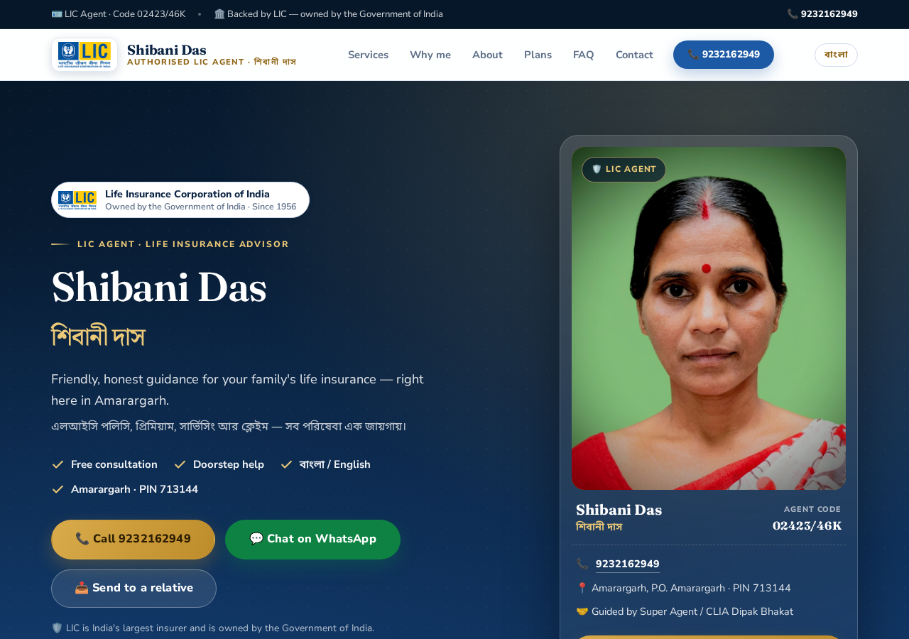
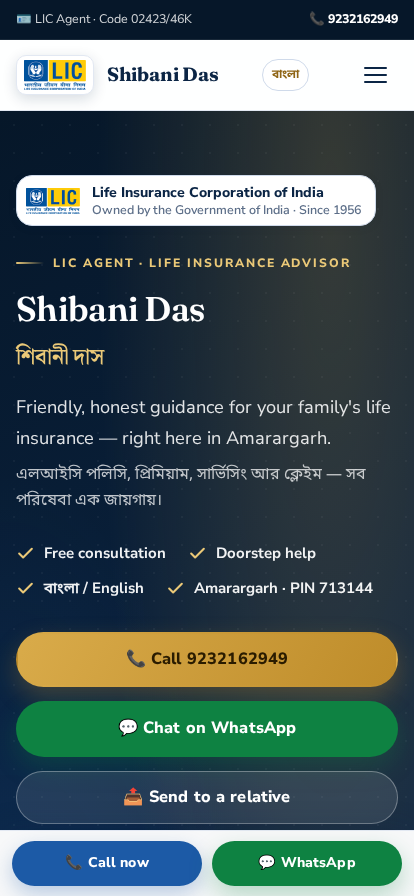
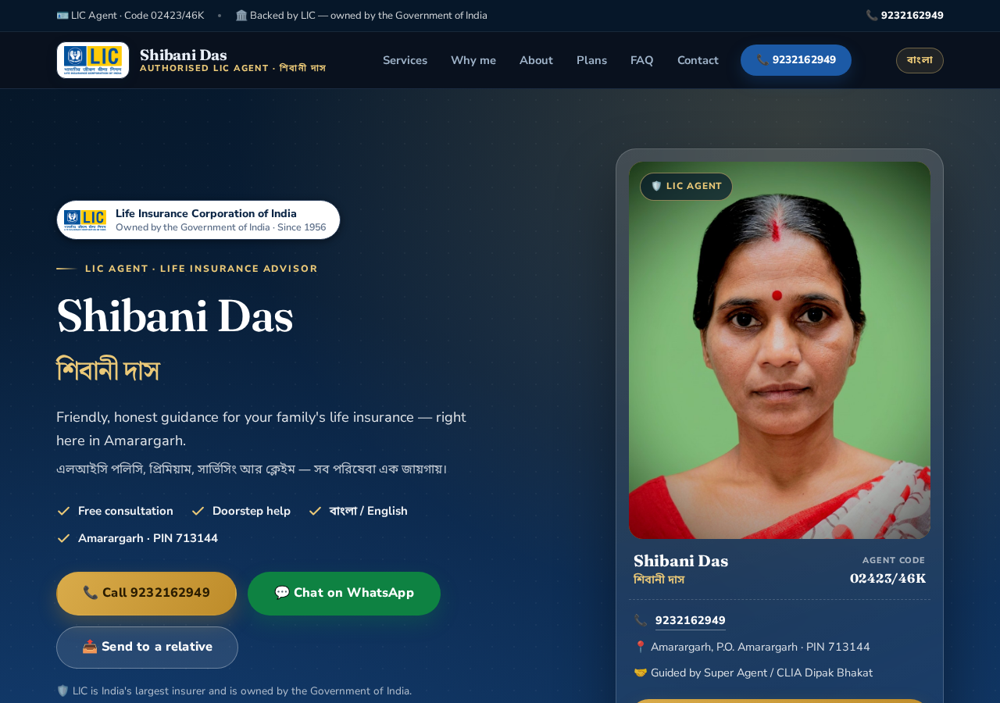
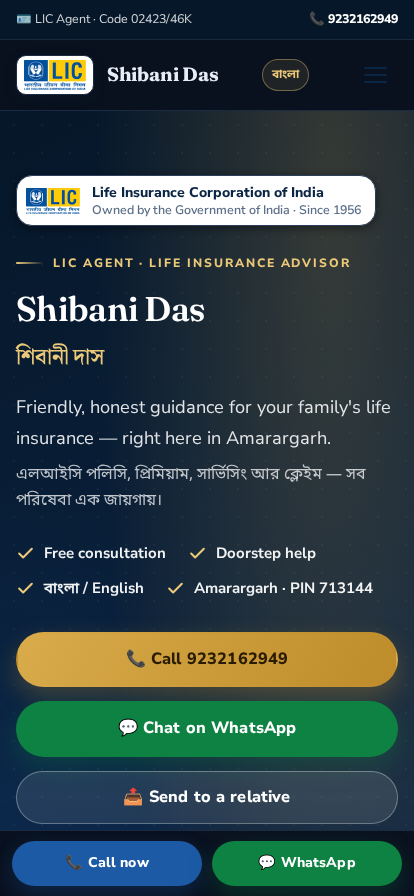

<!--
  ┌───────────────────────────────────────────────────────────────────────┐
  │  GITHUB_README.md — showcase landing page for this repository          │
  │                                                                        │
  │  Rename this file to README.md when this folder becomes its own GitHub │
  │  repository, so it appears as the repo's front page.                   │
  └───────────────────────────────────────────────────────────────────────┘
-->

<div align="center">


# Shibani Das · LIC Agent

**শিবানী দাস**

A clean, fast, **100 % static** website advertising the LIC insurance agentship services of
**Shibani Das** — Amarargarh, West Bengal, India (PIN **713144**).

<br>

[](https://shibanidaslic.github.io/)
[](tel:+919232162949)

<br>

[](#)
[](#)
[](#)
[](#)
[](#)
[](#)
[](#)
[](#)
[](#)

Made with ❤️ in West Bengal, India 🇮🇳

</div>

---

## 📖 Overview

This is a single-page advertisement / contact website for an **individual LIC agent**. It explains the
services offered, builds trust, and makes it dead simple for a visitor to **call** or **WhatsApp**.

The design is **trust-first**: it leads with the person (a real photo and an ID-style card), shows the
agent code openly, uses the official **LIC logo**, reminds visitors that **LIC is owned by the
Government of India**, and keeps every claim honest — the stats use real figures and **no testimonial
is invented**.

There is **no framework, no build step, no backend, no database and no cookie-based tracking**. Just open
`index.html` and it works — which means it loads instantly, costs nothing to host, and will still work
years from now. The whole page is also **fully bilingual** (English ⇄ বাংলা, by visitor choice) and ships
with a complete **dark theme** that follows the system setting. It is tested to render without horizontal
scrolling from **320 px to 1920 px** in both **Chrome/Chromium** and **Firefox**, in **light and dark mode**.

<div align="center">

<table>
  <tr>
    <th colspan="2">☀️ Light mode</th>
  </tr>
  <tr>
    <th width="72%">💻 Desktop</th>
    <th width="28%">📱 Mobile</th>
  </tr>
  <tr>
    <td></td>
    <td></td>
  </tr>
  <tr>
    <th colspan="2">🌙 Dark mode (follows the system setting)</th>
  </tr>
  <tr>
    <td></td>
    <td></td>
  </tr>
</table>

</div>

---

## ✨ Highlights

| | |
| --- | --- |
| 🚀 **Loads in a blink** | Plain HTML, one CSS file, one small JS file. No bundle, and fonts are **self-hosted** — zero CDN dependency. |
| 🛡️ **Trust-first design** | A "Backed by LIC — owned by the Government of India" ribbon, the agent code shown up front, and a real photo of the agent. |
| 🏛️ **Official LIC branding** | The official LIC logo in the header, hero, footer and browser tab, plus a government-undertaking trust band (since 1956). |
| 🪪 **Agent ID card** | A premium hero card with the agent's photo, name in English and Bengali, agent code and supervising senior. |
| 📊 **Honest stats** | Real, editable figures (30+ policies arranged, 50+ families guided, years of service) with animated counters — never invented. |
| 📞 **One-tap contact** | Click-to-call (`tel:`) and WhatsApp (`wa.me`) buttons in the hero, the sticky mobile bar, and the footer. |
| 🌐 **Full English ⇄ বাংলা mode** | A header toggle switches the entire page between English and Bengali (remembered per visitor). |
| 🌙 **Dark mode** | A complete dark theme that follows the operating system's light/dark preference. |
| 📤 **Share to WhatsApp** | "Send to a relative" buttons that share the page via WhatsApp with a ready-made message. |
| 📝 **Call-back form** | Opens WhatsApp with a ready-made message — nothing is stored, no server needed. |
| 📍 **Local &amp; personal** | Address, PIN code and an embedded Google Map for Amarargarh. |
| 🔎 **Search friendly** | Descriptive meta tags, canonical URL, Open Graph, `robots.txt`, `sitemap.xml` and JSON-LD structured data. |
| ♿ **Accessible** | Skip link, focus outlines, ARIA labels, semantic landmarks, `prefers-reduced-motion` support and WCAG AA contrast in both themes. |
| 🧩 **Easy to edit** | All content lives in one `index.html`; all styling in one `style.css`. |

---

## 🧾 Services promoted

| Service | Bengali |
| --- | --- |
| Life insurance policy guidance | জীবন বীমা পলিসি পরামর্শ |
| New policy assistance | নতুন পলিসি সহায়তা |
| Premium payment guidance | প্রিমিয়াম জমার সহায়তা |
| Policy servicing | পলিসি সার্ভিসিং |
| Claim-related assistance | ক্লেইম সংক্রান্ত সহায়তা |

> Plan **categories** covered on the page: Term/Risk cover, Endowment, Money Back, Pension &amp; Annuity,
> Child plans and Investment-Linked (ULIP). Actual benefits are decided by LIC under its prevailing rules.

---

## 📁 Project structure

```
shibani-das-lic/
├── index.html                 # the whole one-page website
├── 404.html                   # friendly "page not found" page
├── css/
│   ├── style.css              # design system (navy + gold) + dark theme
│   └── fonts.css              # self-hosted @font-face rules (latin + Bengali subsets)
├── fonts/                     # locally hosted woff2 fonts (offline-ready)
├── js/
│   ├── i18n.js                # English ⇄ বাংলা language switching
│   └── main.js                # nav, FAQ accordion, scroll effects, WhatsApp form
├── docs/
│   ├── preview-desktop.png    # README screenshot (light)
│   ├── preview-mobile.png     # README screenshot (light)
│   ├── preview-dark-desktop.png  # README screenshot (dark)
│   └── preview-dark-mobile.png   # README screenshot (dark)
├── images/
│   ├── agent.jpg              # the agent's real photo
│   ├── lic-logo.png           # official LIC logo
│   ├── favicon.png            # browser-tab icon  (+ apple-touch-icon.png)
│   └── og-image.jpg           # 1200×630 social-share picture
├── .github/workflows/deploy.yml  # optional GitHub Pages auto-deploy
├── robots.txt
├── sitemap.xml
├── netlify.toml               # optional headers for Netlify
└── README.md                  # full editing &amp; deployment guide
```

---

## 🚀 Quick start

**Option 1 — just open it**

Double-click `index.html`. That's the entire install.

**Option 2 — run a tiny local server** (recommended, so links behave exactly like online)

```bash
# from inside the shibani-das-lic folder
python3 -m http.server 8080
# then open http://localhost:8080
```

---

## 🛠 Tech stack

<div align="center">


</div>

- **Markup:** semantic HTML5
- **Styling:** hand-written CSS with custom properties (design tokens) — no framework; a complete
  `prefers-color-scheme` **dark theme**
- **Behaviour:** vanilla JavaScript — mobile nav, FAQ accordion, scroll reveal, active-link spy, animated counters, WhatsApp form
- **Localisation:** `js/i18n.js` swaps the whole page between **English and Bengali** (browser-language
  default + remembered choice + the top-right toggle)
- **Fonts:** self-hosted woff2 in `fonts/` — Fraunces (headings), Nunito Sans (body), Noto Sans Bengali
  + Noto Serif Bengali — no Google Fonts CDN at runtime, with graceful system fallbacks
- **Icons:** inline SVG + emoji (no icon-font dependency)

**Colour palette**


---

## 🎨 Customization

<details>
<summary><strong>Change the phone number</strong></summary>

<br>

The number appears in several `tel:` / `wa.me` links. Find every occurrence:

```bash
grep -rn "9232162949" .
grep -rn "+919232162949" .
```

The JS config is at the very top of `js/main.js`:

```js
const AGENT_PHONE = "919232162949"; // country code + number, digits only
```

</details>

<details>
<summary><strong>Change the LIC agent code or supervising senior</strong></summary>

<br>

The agent code **02423/46K** and the supervising **Super Agent / CLIA — Dipak Bhakat** are already on
the page — in the hero card, the About section, the contact panel and the `InsuranceAgency` structured
data.

To change them, search `index.html` for `02423/46K` and `Dipak Bhakat` and update every match,
including the `identifier` and `mentor` values in the `application/ld+json` block near the top.

</details>

<details>
<summary><strong>Add a real photo of the agent</strong></summary>

<br>

**No code changes needed.** Save the passport-size photo into the `images/` folder as **`agent.jpg`**
(also accepted: `agent.jpeg`, `agent.png`, `agent.webp`). The site finds it automatically and shows it
in two places:

1. the large portrait on the **hero agent ID card**,
2. the portrait frame in the **About** section.

Until the file exists, a tidy **“SD” monogram** is shown instead, so the layout never looks broken.

> Use a portrait photo, ~600–1000 px on the longest side, under ~300 KB. See `images/README.md`.
> If the crop looks off, tweak `object-position` on `.portrait img` / `.about-photo img` in `style.css`.

</details>

<details>
<summary><strong>Edit the trust stats (policies / families / years)</strong></summary>

<br>

In `index.html`, find the `class="stats"` block in the **About** section:

- `data-count="30"` + `data-suffix="+"` → LIC policies arranged
- `data-count="50"` + `data-suffix="+"` → families guided
- `1–3<span class="unit"> yrs</span>` → your real years of service
- the `₹0` card → cost of advice

The same figures also appear as chips in the About section and in the social-share image
(`images/og-image.jpg`). Please keep these honest — real numbers earn real trust.

</details>

<details>
<summary><strong>Change colours or fonts</strong></summary>

<br>

Everything is driven by CSS variables at the top of `css/style.css`:

```css
:root {
  --navy: #0B2545;
  --blue: #1C5AA6;
  --gold: #BE8C2A;
  /* … */
}
```

</details>

---

## 🌍 Deployment

This is a static site, so it runs on **any** host.

<details>
<summary><strong>Option A — GitHub Pages (user site · fully automatic)</strong></summary>

<br>

If your repository is named **`shibanidaslic.github.io`**, GitHub treats it as a *user site* and serves the
repo root automatically — **no settings, no workflow, no build step**:

1. Create a GitHub repository named exactly **`shibanidaslic.github.io`** (**Public** — free Pages doesn't
   work on private repos).
2. Push these files (repo root) to the default branch, `main`. The site goes live at
   **https://shibanidaslic.github.io/** within a minute or two.

All on-page addresses already match that URL: the `canonical`, Open Graph, `robots.txt` and
`sitemap.xml` all point to `https://shibanidaslic.github.io/`.

</details>

<details>
<summary><strong>Option B — Netlify / Cloudflare Pages / Vercel</strong></summary>

<br>

Connect the repo or drag-and-drop the folder. No build command; publish directory = the project root.
`netlify.toml` already adds security and caching headers.

</details>

<details>
<summary><strong>Option C — any shared hosting / FTP</strong></summary>

<br>

Upload the folder contents. `index.html` is the entry point.

</details>

---

## 🔍 SEO, performance &amp; accessibility

- **SEO:** unique title &amp; description, keywords, canonical link, Open Graph + Twitter cards,
  `InsuranceAgency` and `FAQPage` JSON-LD, `robots.txt` and `sitemap.xml`.
- **Performance:** no frameworks, no JavaScript bundler, **self-hosted fonts** (latin + Bengali subsets,
  no CDN), lazy-loaded map, minimal blocking resources.
- **Accessibility:** skip-to-content link, visible focus states, ARIA on interactive controls,
  `aria-live` form status, reduced-motion support, WCAG AA text contrast in **both light and dark**
  themes, and `lang` switching so screen readers announce the right language. There is also a
  `<noscript>` fallback so content is never hidden if JavaScript is off.
- **Privacy:** optional cookie-free visitor counts via [GoatCounter](https://www.goatcounter.com)
  (register a free account and put your code in `index.html` — see `README.md`).

---

## 📇 Contact

- **Agent:** Shibani Das (শিবানী দাস) — LIC Agent
- **Agent Code:** 02423/46K
- **Supervising Senior:** Super Agent / CLIA — Dipak Bhakat
- **Mobile / WhatsApp:** [**9232162949**](tel:+919232162949) · [+91 92321 62949](https://wa.me/919232162949)
- **Address:** Amarargarh, P.O. Amarargarh, PIN 713144, West Bengal, India
- **Usual hours:** Monday – Saturday, 9:00 AM – 8:00 PM

---

## ⚠️ Disclaimer

This is the **personal information page of an individual LIC agent**. It is **not** the official website
of the Life Insurance Corporation of India. LIC, its plans, terms and benefits are governed by the
Corporation's prevailing rules and are subject to change. The **LIC logo** is used only to identify the
agent's LIC agentship and remains the trademark of the Life Insurance Corporation of India.

<div align="center">
<br>

**If this site helped a family find their way to insurance, it did its job.** 🙏

<br>
</div>
